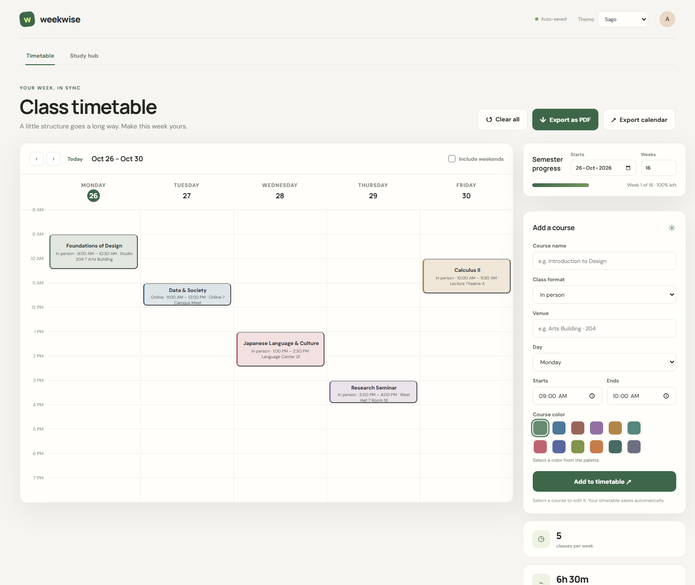
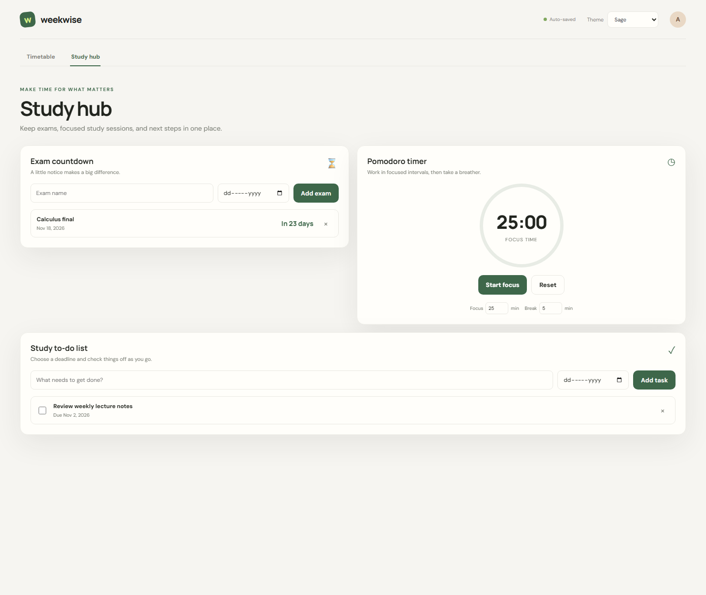

# Weekwise

Weekwise is a lightweight weekly timetable and study planner that runs directly in a modern browser. It helps students organize recurring classes, track a semester, and keep study tasks in one place.

## Screenshots

## Features

- Create and edit recurring classes with a course name, day, start and end time, venue, and in-person or online format.
- View a weekly timetable, with an option to include Saturday and Sunday.
- Choose course colors from a grid palette. Classes with the same course name share a color.
- Automatically save timetable, semester, exam, to-do, and theme settings in the browser.
- Set a semester start date and length to see semester progress.
- Export the timetable as a printable PDF or a recurring iCalendar (`.ics`) file. Calendar export can optionally stop on a selected end date.
- Use the Study Hub for exam countdowns, a Pomodoro timer, and deadline-based tasks.
- Choose from seven visual themes.

## Architecture

Weekwise is intentionally a static app: it has no backend, account system, build step, or third-party JavaScript dependencies. This keeps it quick to host on GitHub Pages and lets timetable data remain in the user's browser rather than requiring a service to store it.

- `index.html` contains the page structure and form controls.
- `styles.css` provides responsive layouts, themes, animations, and print styles.
- `app.js` handles timetable and Study Hub interactions, browser storage, and PDF/calendar exports.

The browser's `localStorage` is the only data store. The app has no framework or package-install requirement.

## Run locally

Serve the repository directory with any static HTTP server and open it in a current browser; this gives browser storage a consistent origin. GitHub Pages hosts the deployed version at [tzenyuan.github.io/weekwise-timetable](https://tzenyuan.github.io/weekwise-timetable/).

## Testing guide

There is no build step or automated test runner. Check the app in a current desktop browser:

1. Open the app in a current desktop browser, add classes on different weekdays, and confirm the weekly view, editing, weekend toggle, and automatic save work after a reload.
2. Change a course color and verify that another class with the same course name uses that color. Try each theme and check the layout at a narrow window width.
3. Set the semester start date and number of weeks, then verify the displayed progress. Add an exam and a to-do with a deadline; check the countdown, completion checkbox, and Pomodoro controls.
4. Export a PDF and open the `.ics` file in a text editor. For calendar-export edge cases, use a long course name and venue containing commas and semicolons, include non-English text, and choose an end date near the end of the semester. Check that text is preserved, special characters are escaped, long lines are folded, recurring events stop at the chosen date, and classes after it are excluded. The export end date is optional.
5. Import the `.ics` file into a calendar app to verify its display and recurrence. This final import depends on the calendar application and is not performed automatically by Weekwise.

## Known limitations

- Data is stored only in the current browser profile. It is not synchronized between devices, and clearing that profile's site data removes it.
- PDF export uses the browser's print dialog; choose “Save as PDF” there.
- Calendar import and display can vary between calendar applications. The `.ics` export is a recurring schedule, not a connection that syncs future edits.
- Weekwise does not have accounts, cloud backup, notifications, or collaboration.

## License

Released under the MIT License. See [LICENSE](LICENSE).
