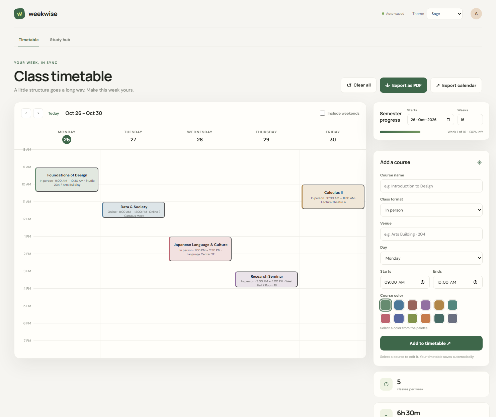
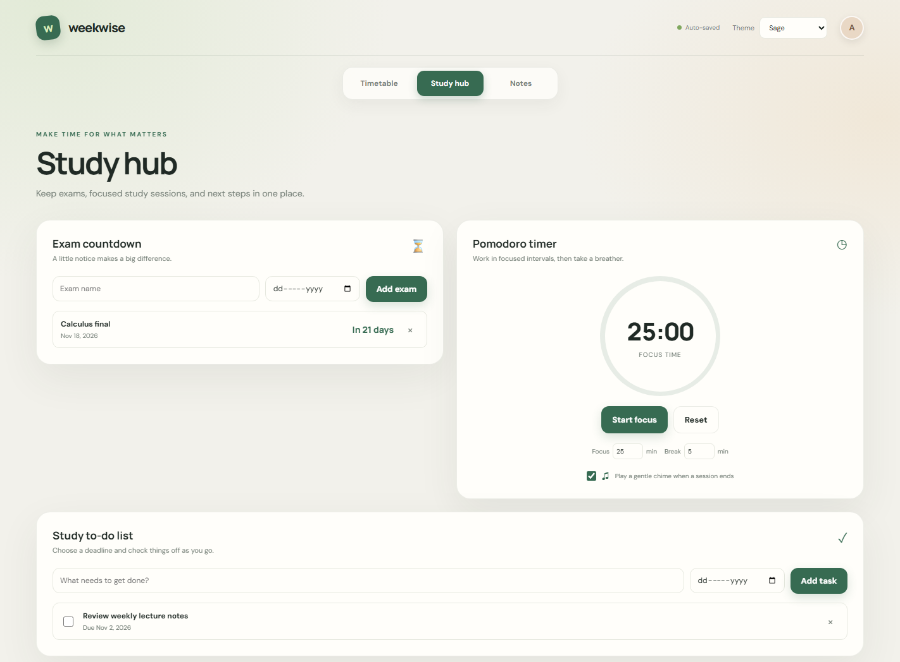
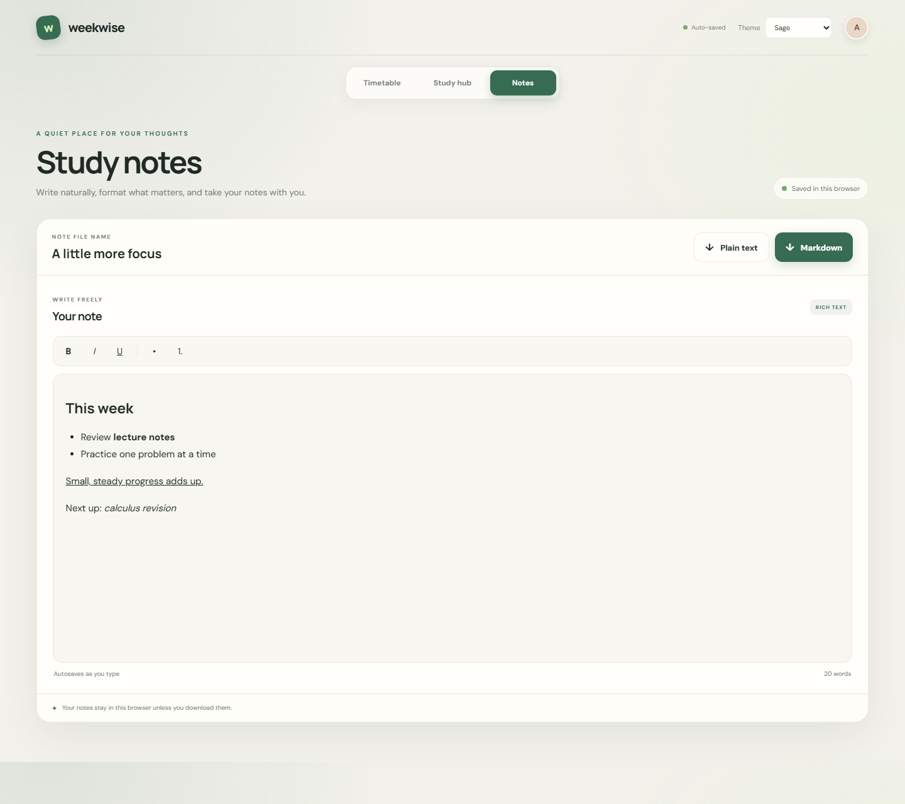

# Weekwise

Weekwise is a lightweight weekly timetable and study planner that runs directly in a modern browser. It helps students organize recurring classes, track a semester, and keep study tasks in one place.

## Screenshots

## Features

- Create and edit recurring classes with a course name, day, start and end time, venue, and in-person or online format.
- Label each class as a lecture or tutorial.
- View a weekly timetable, with an option to include Saturday and Sunday.
- Schedule classes to the minute on an aligned hourly grid with quarter-hour guides.
- Choose from 18 distinct course colors in a grid palette. Classes with the same course name share a color.
- Automatically save timetable, semester, exam, to-do, and theme settings in the browser.
- Set a semester start date and length to see semester progress.
- Export the timetable as a printable PDF or a recurring iCalendar (`.ics`) file. Calendar export can optionally stop on a selected end date.
- Use the Study Hub for exam countdowns, a Pomodoro timer, and deadline-based tasks.
- Write and format notes directly with bold, italic, underline, and lists. Notes autosave in the browser and can be downloaded as `.txt` or `.md`.
- Hear an optional, more prominent Pomodoro ringtone; preview it before starting a session.
- Ask general questions in the floating AI chat. The browser talks to a Cloudflare Worker, which keeps the OpenRouter API key server-side.
- Choose from seven visual themes.

## Architecture

The timetable, Study Hub, and Notes remain a static app with no account system, build step, or third-party JavaScript dependencies. Their data stays in the user's browser. The optional AI chat uses a small Cloudflare Worker as a secure API proxy; the OpenRouter key is configured as a Worker secret and is never sent to or stored in the browser.

- `index.html` contains the page structure and form controls.
- `styles.css` provides responsive layouts, themes, animations, and print styles.
- `app.js` handles timetable, Study Hub, notes, AI chat UI, browser storage, and file exports.
- `worker/src/index.js` validates chat requests and calls OpenRouter without exposing the API key.

Timetable and study data use browser `localStorage`. Chat history stays in memory for the current page and is sent to OpenRouter through the Worker when asking follow-up questions.

## Run locally

Serve the repository directory with any static HTTP server and open it in a current browser; this gives browser storage a consistent origin. GitHub Pages hosts the deployed version at [tzenyuan.github.io/weekwise-timetable](https://tzenyuan.github.io/weekwise-timetable/).

## Enable AI chat

The AI chat needs a Cloudflare Worker and an OpenRouter API key. Never put an API key in `app.js`, the HTML, GitHub, or the chat endpoint setting. The key previously pasted into a chat is exposed; revoke it and create a replacement before configuring the Worker.

1. In `worker/wrangler.toml`, adjust `ALLOWED_ORIGINS` if you use a different published site origin. The default allows this GitHub Pages site and local development on port 8000.
2. Install Node.js, open a terminal in `worker`, then run `npx wrangler login`.
3. Run `npx wrangler secret put OPENROUTER_API_KEY` and paste the **replacement** key into Wrangler's secure prompt. This stores the key as a Cloudflare Worker secret.
4. Run `npx wrangler deploy` and copy the resulting Worker URL.
5. On Weekwise, open **Ask Weekwise AI**, select the settings icon, paste the Worker URL ending in `/api/chat`, and save.

The Worker only accepts configured origins, caps messages/history, and limits each IP to 10 requests per minute. Change that limit in `worker/wrangler.toml` if needed. The model defaults to `openai/gpt-4o-mini`; change `OPENROUTER_MODEL` in the same file to select another model available to your OpenRouter account. OpenRouter usage may incur charges.

## Testing guide

There is no build step or automated test runner. Check the app in a current desktop browser:

1. Open the app in a current desktop browser, add classes on different weekdays, and confirm the weekly view, editing, weekend toggle, and automatic save work after a reload.
2. Change a course color and verify that another class with the same course name uses that color. Try each theme and check the layout at a narrow window width.
3. Set the semester start date and number of weeks, then verify the percentage complete. Add an exam and a to-do with a deadline; check the countdown, completion checkbox, Pomodoro controls, and optional session-end chime.
4. Export a PDF and open the `.ics` file in a text editor. For calendar-export edge cases, use a long course name and venue containing commas and semicolons, include non-English text, and choose an end date near the end of the semester. Check that text is preserved, special characters are escaped, long lines are folded, recurring events stop at the chosen date, and classes after it are excluded. The export end date is optional.
5. In Notes, type normally, select text, apply bold/italic/underline and lists, then reload to check autosave and download both file formats. Confirm the Markdown download preserves formatting.
6. Import the `.ics` file into a calendar app to verify its display and recurrence. This final import depends on the calendar application and is not performed automatically by Weekwise.
7. Configure the Cloudflare Worker URL in the AI chat settings, ask a question, and ask a follow-up to verify context. Confirm an unapproved origin, invalid request, and requests over the configured rate limit are rejected.

## Known limitations

- Data is stored only in the current browser profile. It is not synchronized between devices, and clearing that profile's site data removes it.
- PDF export uses the browser's print dialog; choose “Save as PDF” there.
- Calendar import and display can vary between calendar applications. The `.ics` export is a recurring schedule, not a connection that syncs future edits.
- Underlined text in `.md` exports uses the widely supported inline HTML `<u>` tag because standard Markdown has no underline syntax.
- AI chat requires the separately deployed Cloudflare Worker and a valid OpenRouter key. Chat messages are sent to OpenRouter for processing; chat history is not saved by Weekwise.
- Weekwise does not have accounts, cloud backup, notifications, or collaboration.

## License

Released under the MIT License. See [LICENSE](LICENSE).
